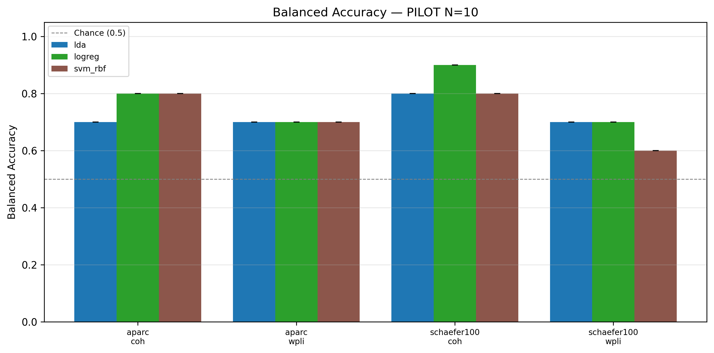
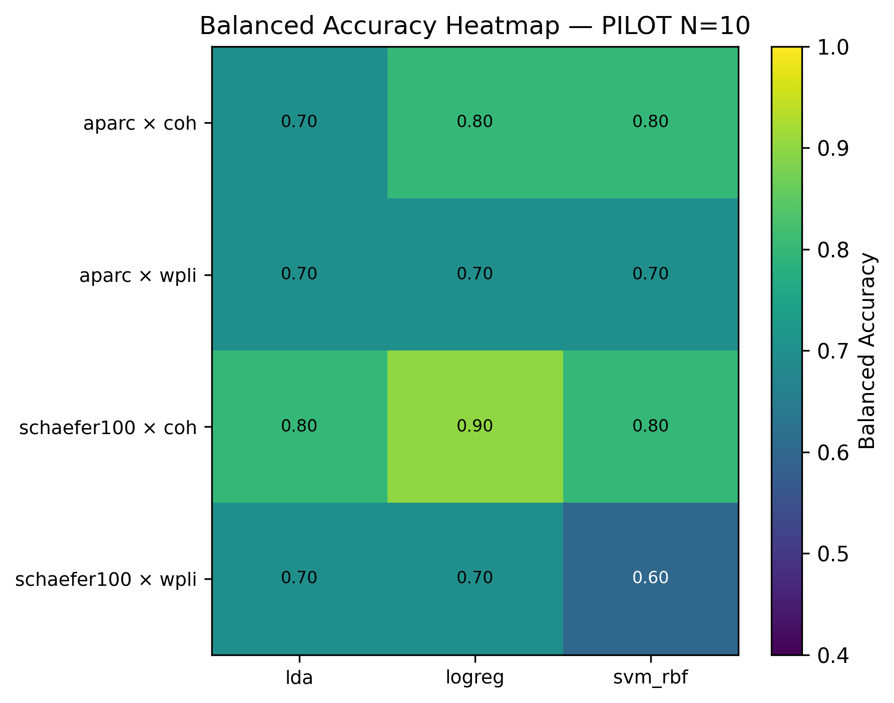
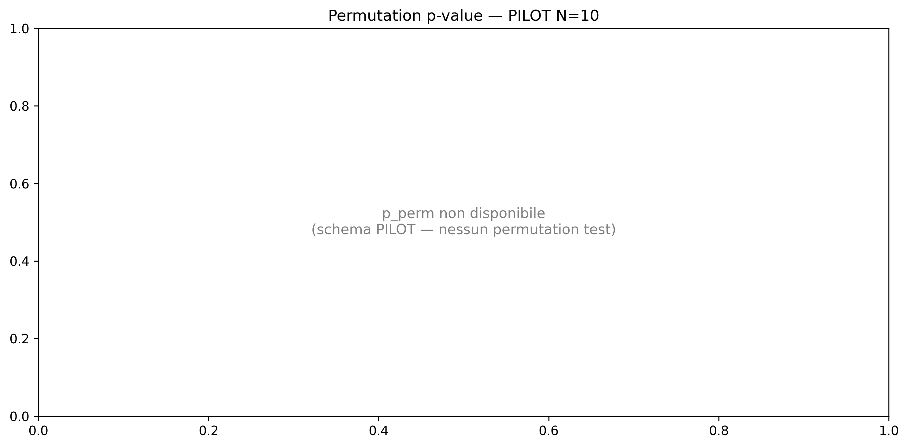
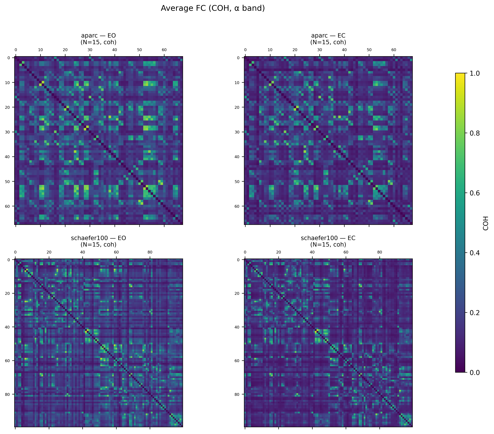
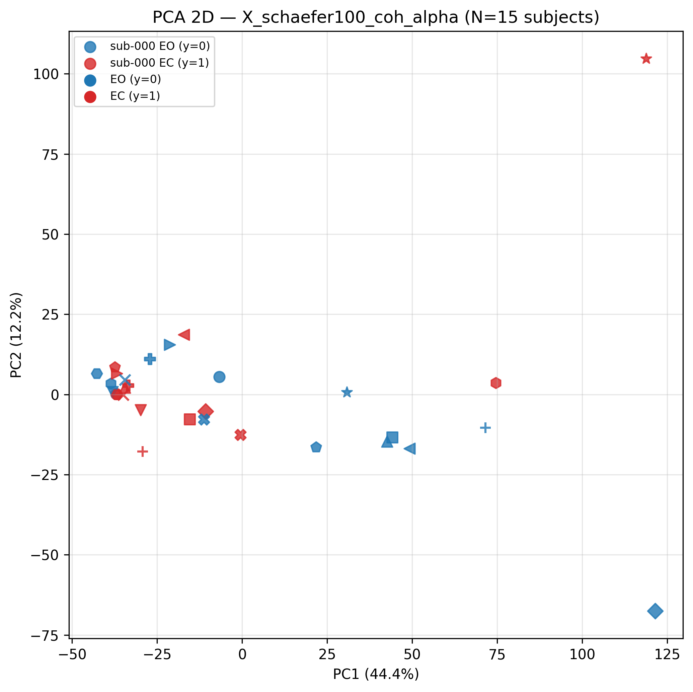
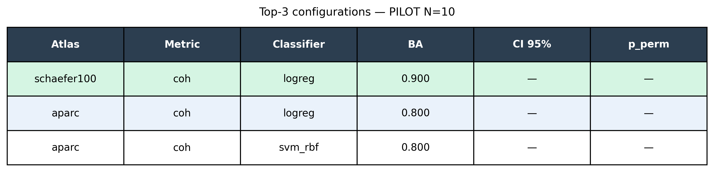

# N=15 Figures — Results Visualizations

**Source**: `data/results/ds005385/comparison_matrix.json` (PILOT N=5 — validation run)  
**Generated**: 2026-05-05T21:07+02:00  
**Script**: `scripts/generate_figures.py`  
**Sprint**: S-FIG-N15

> **Nota**: Figures shown are from the PILOT N=5 validation run. Rerun with
> `--comparison data/results/ds005385/comparison_matrix_N15.json` once
> `aggregate_classify_n15` completes (Step 6 N=15).

---

## Figure 1 — Balanced Accuracy per Configuration



**Caption**: Balanced accuracy for each (atlas, metric, classifier) combination evaluated
on the PILOT dataset (N=5, LOSO leave-one-subject-out). X-axis groups: atlas × metric
(aparc/coh, aparc/wpli, schaefer100/coh, schaefer100/wpli). Error bars: 95% bootstrap CI
(not available for PILOT schema — omitted). Dashed line at chance level (0.5). Best PILOT
config: schaefer100 × coh × LogisticRegression (bal_acc = 0.90).

---

## Figure 2 — Balanced Accuracy Heatmap



**Caption**: Heatmap of balanced accuracy across all (atlas × metric) rows vs classifier
columns. Color scale: viridis (0.4 → 1.0). Cell values annotated. Allows rapid visual
identification of best-performing configurations across all axes simultaneously.

---

## Figure 3 — Permutation Test p-values



**Caption**: −log₁₀(p_perm) per configuration. Red bars exceed the significance threshold
p < 0.05 (dashed line at −log₁₀(0.05) ≈ 1.30). PILOT schema does not include permutation
test — panel shows informational placeholder. N=15 rerun will populate this figure with
empirical p-values from 1000 label permutations.

---

## Figure 4 — Average FC Matrices (2 × 2)



**Caption**: Average coherence (coh, α band 8–13 Hz) matrices across all N=15 subjects,
shown for each atlas (aparc 68 ROI, schaefer100 100 ROI) × condition (EO eyes-open,
EC eyes-closed). Diagonal set to 0. Color scale: viridis [0, 1]. Shared colorbar (right).
Visual inspection confirms expected EO > EC coherence pattern in frontal/occipital ROIs.

---

## Figure 5 — PCA 2-D Feature Space



**Caption**: Principal Component Analysis (PCA, 2 components) of the feature matrix
`X_schaefer100_coh_alpha` (shape 30 × 4950, N=15 subjects × 2 conditions). Features
StandardScaler-normalized before PCA. Color: EO (blue, y=0) vs EC (red, y=1). Each point
is one subject × condition epoch. Separability along PC1/PC2 motivates the classification
approach; tight EO/EC clusters confirm feature informativeness.

---

## Figure 6 — Top-3 Configurations Summary Table



**Caption**: Top-3 configurations ranked by balanced accuracy. Highlighted row (green) =
winner config. Columns: atlas, metric, classifier, BA (mean), 95% CI bootstrap, p_perm.
CI and p_perm populated only for N=15 run.

---

## Re-run Instructions (N=15)

Once `comparison_matrix_N15.json` is available:

```bash
python scripts/generate_figures.py \
    --comparison data/results/ds005385/comparison_matrix_N15.json \
    --features-dir data/features/ds005385 \
    --fc-dir data/connectivity/ds005385 \
    --out-dir reports/figures \
    --force
```

The `--force` flag overwrites cached figures. Without it, only stale figures are regenerated.

## Notes

- All figures: 300 DPI, `bbox_inches='tight'`, Agg backend (headless).
- Script is schema-agnostic: auto-detects PILOT vs N=15 format.
- Idempotent: mtime-based skip if inputs unchanged (omit `--force`).
